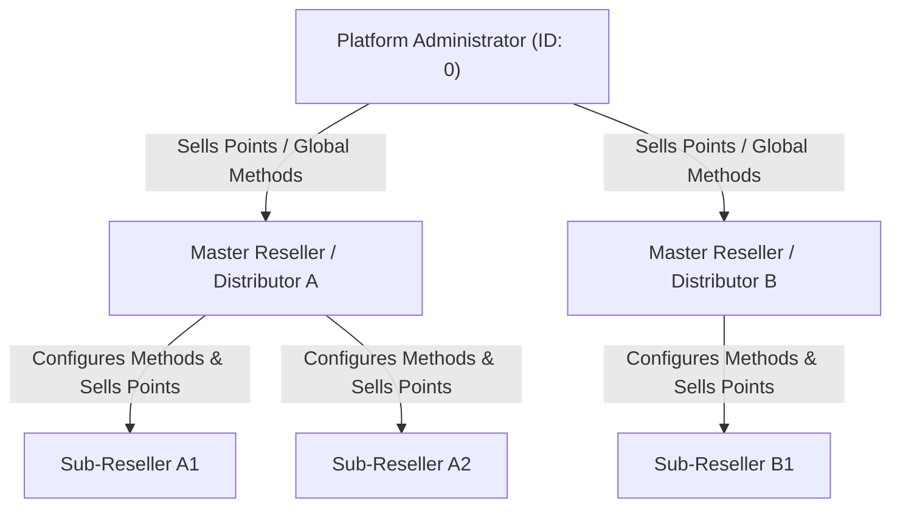
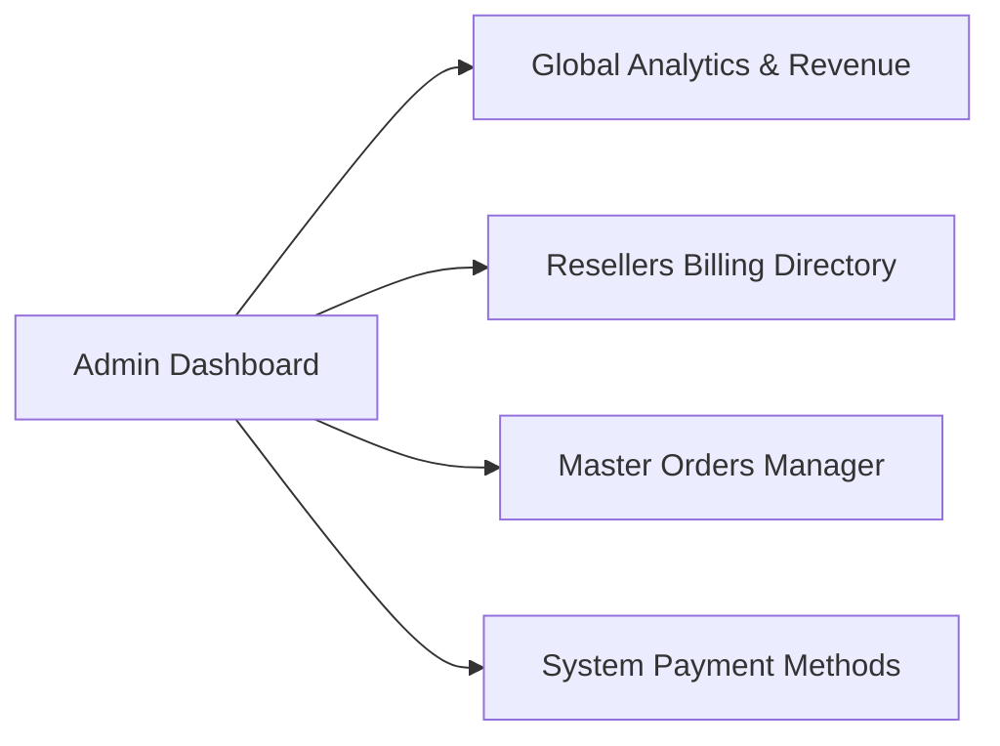
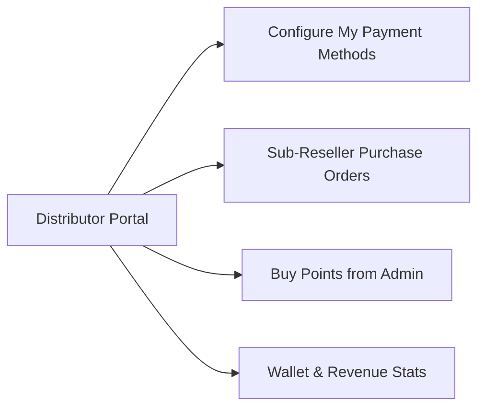
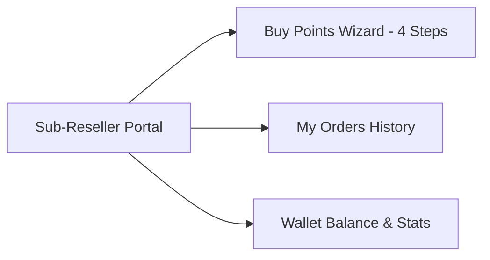
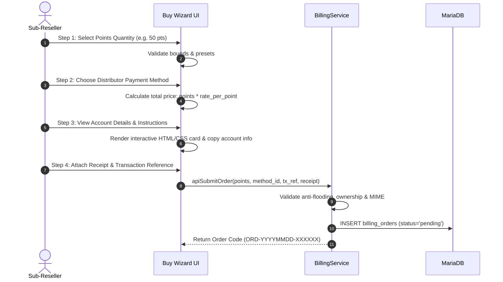
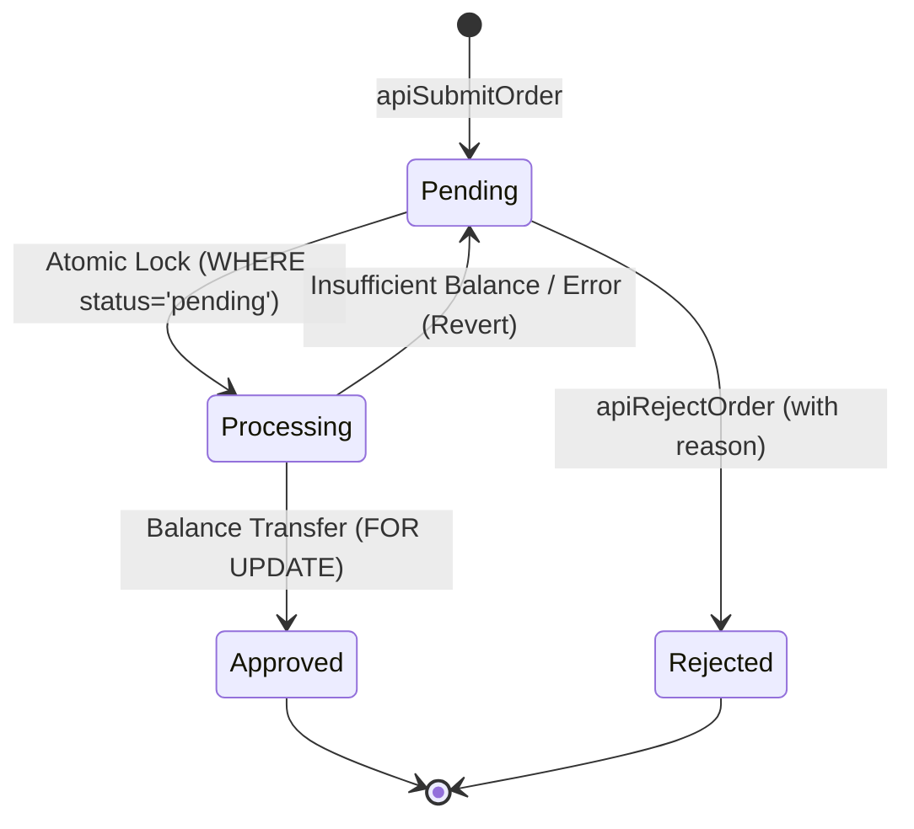

# XC_VM Billing & Points Management Module

[](https://github.com/Rosmi720/Module_Billing/releases)
[](https://php.net/)
[](https://github.com/Vateron-Media/XC_VM)
[](#multilingual--internationalization-i18n-engine)
[](#security-architecture--threat-model)
[](https://www.gnu.org/licenses/agpl-3.0.html)

A production-grade, enterprise-ready **Billing, Points Transfer, Financial Analytics, and Payment Gateway Management Module** built specifically for the **XC_VM** IPTV management platform.

This module provides a multi-tier financial ecosystem enabling **Platform Administrators**, **Master Resellers (Distributors)**, and **Sub-Resellers** to configure custom payment methods, track cash flow & revenue velocity via the **Finance & Accounting Hub**, execute self-service point purchase workflows, review payment receipts, audit sub-resellers, and atomically transfer credits with zero-trust concurrency protection.

---

## Table of Contents

1. [Architectural Overview](#architectural-overview)
2. [Multi-Tier Role Guides](#multi-tier-role-guides)
   - [1. Platform Administrator Guide](#1-platform-administrator-guide)
   - [2. Master Reseller (Distributor) Guide](#2-master-reseller-distributor-guide)
   - [3. Sub-Reseller (Buyer) Guide](#3-sub-reseller-buyer-guide)
3. [4-Step Points Purchase Wizard](#4-step-points-purchase-wizard)
4. [Security Architecture & Threat Model](#security-architecture--threat-model)
   - [Zero-Trust Multi-Tenancy (Anti-IDOR)](#zero-trust-multi-tenancy-anti-idor)
   - [Concurrency Locking & Double-Spending Elimination](#concurrency-locking--double-spending-elimination)
   - [Atomic Balance Transfers (Pessimistic Locking)](#atomic-balance-transfers-pessimistic-locking)
   - [Stored XSS & Anti-Hijacking Engine](#stored-xss--anti-hijacking-engine)
   - [Anti-Flooding & Rate Limiting Gates](#anti-flooding--rate-limiting-gates)
   - [Isolated Receipt Storage & Path Traversal Guards](#isolated-receipt-storage--path-traversal-guards)
   - [Immutable Cryptographic Audit Trail](#immutable-cryptographic-audit-trail)
5. [Database Schema](#database-schema)
6. [Installation & Lifecycle](#installation--lifecycle)
7. [Automated Security Verification](#automated-security-verification)
8. [Multilingual & Internationalization (i18n) Engine](#multilingual--internationalization-i18n-engine)

---

## Architectural Overview

The Billing Module operates within the XC_VM modular monolith, adhering to strict clean-architecture boundaries:
- **No Core File Modifications**: Routes, navigation, and services are hooked via XC_VM provider interfaces (`RouteProviderInterface`, `NavbarProviderInterface`, `ResellerNavbarProviderInterface`).
- **Database Isolation**: Database access resolves lazily through the `\XcVm\Infrastructure\Database\DatabaseAware` trait (`self::db()`).
- **Multi-Tenancy Hierarchy**:
  - **Admin (Platform Owner)**: Top of the hierarchy; sells points to top-tier Master Resellers.
  - **Master Reseller (Distributor)**: Buys points from Admin; sets up proprietary payment methods; distributes points down to their sub-resellers.
  - **Sub-Reseller (End-Tier)**: Purchases points directly from their parent distributor using distributor-defined payment methods.



---

## Multi-Tier Role Guides

### 1. Platform Administrator Guide

Administrators have global visibility and master oversight across the entire platform.



#### Key Capabilities:
- **Billing & Points Overview (`/billing/overview`)**:
  - Live analytics cards: Total Orders, Approved Volume, Pending Review, Total Revenue, and Total Points Sold.
  - Recent purchase orders table with real-time status indicators.
- **Resellers Billing Directory (`/billing/resellers`)**:
  - Complete list of registered resellers, their current credit balances, number of sub-resellers, active payment methods, and total volume sold.
  - **Drill-Down Modal (`apiDrilldown`)**: View detailed financial profile, payment methods, order history, and audit logs for any reseller without leaving the page.
- **Master Orders Management (`/billing/orders`)**:
  - Search and filter all purchase orders across the system by status (`pending`, `approved`, `rejected`), order code, or buyer/seller username.
  - Inspect transfer slips and receipts in high-resolution modal.
  - Direct approval/rejection capability with custom administrative notes.
- **Admin Payment Methods (`/billing/methods?type=admin`)**:
  - Configure platform-level payment methods used when top resellers buy points directly from the panel owner.
  - Rich HTML/CSS WYSIWYG editor for instructions with live interactive preview.

---

### 2. Master Reseller (Distributor) Guide

Master Resellers (users with `create_sub_resellers` permission, existing sub-resellers, or direct Admin parentage) act as regional distributors.



#### Key Capabilities:
- **Distributor Dashboard (`/billing`)**:
  - View incoming pending orders requiring action.
  - Monitor sales revenue, approved orders, and current distributor credit balance.
  - Quick access to buying points from Admin when distributor stock runs low.
- **My Payment Methods (`/billing/methods`)**:
  - Define custom payment channels for sub-resellers (e.g., Bank Transfer, Vodafone Cash, InstaPay, Crypto USDT TRC20, PayPal, Western Union).
  - Define individual **Price Rate per Point** (e.g., `1.50 USD` or `75.00 EGP` per credit).
  - Set minimum and maximum purchase bounds per transaction.
  - Create rich interactive instructions using HTML, CSS cards, copy-to-clipboard buttons, QR codes, and custom widgets.
  - Toggle active/inactive state or delete methods at any time.
- **Sub-Reseller Orders Review (`/billing/orders`)**:
  - Real-time review modal displaying the buyer's requested points, calculated price, transaction reference number, and payment receipt slip.
  - **Instant Balance Check**: The UI warns the distributor if their current balance is insufficient to fulfill the order, displaying the exact deficit.
  - **One-Click Approval**: Transfers points atomically from the distributor's balance to the sub-reseller's balance.
  - **Rejection with Reason**: Allows the distributor to decline an invalid payment with feedback to the sub-reseller.

---

### 3. Sub-Reseller (Buyer) Guide

Sub-Resellers enjoy a seamless, self-service shopping experience for points without needing manual admin intervention.



#### Key Capabilities:
- **Sub-Reseller Dashboard (`/billing`)**:
  - View current wallet credit balance.
  - View total points purchased and recent order progress.
  - Direct contact and payment channel overview of their designated distributor.
- **Self-Service Points Wizard (`/billing/buy`)**:
  - Intuitive 4-step wizard to order points from their designated distributor.
- **My Orders History (`/billing/my_orders`)**:
  - Track order lifecycle: `Pending Verification`, `Approved & Credited`, or `Rejected`.
  - Re-inspect submitted transfer proofs, transaction references, and reviewer rejection reasons.

---

## 4-Step Points Purchase Wizard

The point purchase interface (`billing_buy`) guides users through a structured 4-step flow:



1. **Step 1: Quantity**: Enter custom points or click quick preset buttons (`+10`, `+25`, `+50`, `+100`, `+250`, `+500`).
2. **Step 2: Payment Method**: Select from methods configured by the user's direct distributor. Displays rates and bounds.
3. **Step 3: Instructions & Account Details**: Renders uncorrupted, styled HTML instructions (bank account, phone wallet, crypto QR code) with a copy button.
4. **Step 4: Confirmation & Upload**: Enter transaction reference / sender phone / TXID, optional notes, attach transfer proof screenshot, and submit.

---

## Security Architecture & Threat Model

The module adheres to a **Zero-Trust Security Model** across all layers.

### Zero-Trust Multi-Tenancy (Anti-IDOR)
- **Designated Seller Enforcement**: Every order is strictly locked to the buyer's parent distributor (`owner_id`) or Admin (`0`). The client cannot specify or tamper with `seller_id`.
- **Payment Method Isolation**: A buyer cannot submit an order using a payment method belonging to a different reseller.
- **Action Authorization**: Only the designated seller or Platform Admin can approve or reject an order. Third-party resellers receive `403 Permission Denied`.
- **Self-Approval Elimination**: A buyer can never approve their own order to fraudulently mint credits.

### Concurrency Locking & Double-Spending Elimination
To prevent race conditions where rapid simultaneous requests attempt to approve the same pending order twice:
```php
// Step 1: Concurrency State-Transition Atomic Lock
$db->query(
    'UPDATE `billing_orders` SET
        `status` = \'processing\',
        `processed_by` = ?,
        `processed_at` = ?,
        `updated_at` = ?
    WHERE `id` = ? AND `status` = \'pending\';',
    $reviewerId, $now, $now, $orderId
);

$affected = method_exists($db, 'affected_rows') ? $db->affected_rows() : (int) $db->num_rows();
if ($affected !== 1) {
    return ['success' => false, 'error' => 'Order is already being processed or resolved.'];
}
```
Only the first request transitions the status from `pending` to `processing`. Any concurrent request receives `0` affected rows and is instantly aborted.

### Atomic Balance Transfers (Pessimistic Locking)
- Points are transferred using `\XcVm\Domain\User\UserCredits::transfer()`.
- Rows are locked using `SELECT ... FOR UPDATE` within a database transaction (`beginTransaction()` / `commit()` / `rollback()`).
- If the distributor's balance is insufficient, the transaction rolls back completely and the order safely reverts to `pending`. Negative balances are mathematically impossible.



### Stored XSS & Anti-Hijacking Engine
Payment instructions allow distributors to provide styled HTML/CSS cards and interactive JS widgets (such as copy-to-clipboard and currency calculators). To prevent credential exfiltration:
- **Anti-Cookie Theft**: Patterns targeting `document.cookie` and `window.document.cookie` are stripped.
- **HttpOnly & SameSite=Strict**: Core XC_VM session cookies enforce `HttpOnly` and `SameSite=Strict`, making session tokens invisible to JavaScript by browser design.
- **Anti-Storage Theft**: Access to `localStorage` and `sessionStorage` is blocked.
- **Anti-Phishing Navigation**: Hijacking attempts on `location.href`, `location.replace()`, and `window.location` are neutralized.
- **Anti-Embedding / Clickjacking**: Tags like `<iframe>`, `<object>`, `<embed>`, and `<meta>` are removed.
- **Anti-Exfiltration**: Native execution of `eval()`, `new Function()`, `fetch()`, `XMLHttpRequest`, and `WebSocket` is blocked.

### Anti-Flooding & Rate Limiting Gates
- **15-Second Cooldown**: Enforces a minimum 15-second gap between consecutive order submissions by the same user.
- **3-Pending-Orders Ceiling**: A user cannot create a 4th pending order while 3 orders are already awaiting review.

### Isolated Receipt Storage & Path Traversal Guards
- **Storage Isolation**: Receipts are stored in `/home/xc_vm/storage/billing_receipts/` outside the web document root (`Public/`). Direct URL access and PHP execution are blocked via `.htaccess` (`php_flag engine off`).
- **Cryptographic File Naming**: Uploaded files are renamed using SHA-256 random hashes:
  ```php
  $safeName = hash('sha256', uniqid('receipt_', true) . bin2hex(random_bytes(8))) . '.' . $ext;
  ```
- **Strict Path Confinement**: The receipt streaming controller verifies paths using `basename()`, `realpath()`, and `str_starts_with()`:
  ```php
  $realDir = realpath(BillingService::UPLOAD_DIR);
  $realPath = realpath($filePath);
  if (!$realPath || !$realDir || !str_starts_with($realPath, $realDir . DIRECTORY_SEPARATOR)) {
      http_response_code(403);
      exit;
  }
  ```
- **MIME Inspection**: File types are inspected via `finfo_file(FILEINFO_MIME_TYPE)`. Executables and fake extensions are rejected.

### Immutable Cryptographic Audit Trail
All financial actions (`order_created`, `order_approved`, `order_rejected`, `method_created`, etc.) are recorded in `billing_logs`. Every entry includes a SHA-256 HMAC integrity signature:
```php
$signString = implode('|', [$action, $orderId, $userId, $targetUserId, $ip, $timestamp, $jsonPayload]);
$payload['_sig'] = hash('sha256', $signString . '|' . $salt);
```

---

## Database Schema

The module manages 3 dedicated database tables:

### 1. `billing_payment_methods`
Stores platform and distributor payment channels:
```sql
CREATE TABLE IF NOT EXISTS `billing_payment_methods` (
    `id` INT UNSIGNED NOT NULL AUTO_INCREMENT PRIMARY KEY,
    `reseller_id` INT UNSIGNED NOT NULL DEFAULT 0,
    `name` VARCHAR(255) NOT NULL,
    `slug` VARCHAR(255) NOT NULL,
    `icon` VARCHAR(100) NOT NULL DEFAULT 'ti tabler-credit-card',
    `instructions` MEDIUMTEXT NULL,
    `rate_per_point` DECIMAL(12,4) NOT NULL DEFAULT 1.0000,
    `currency` VARCHAR(10) NOT NULL DEFAULT 'USD',
    `min_points` INT UNSIGNED NOT NULL DEFAULT 1,
    `max_points` INT UNSIGNED NOT NULL DEFAULT 0,
    `active` TINYINT(1) NOT NULL DEFAULT 1,
    `sort_order` INT NOT NULL DEFAULT 0,
    `created_at` INT UNSIGNED NOT NULL,
    `updated_at` INT UNSIGNED NOT NULL,
    INDEX `idx_reseller_active` (`reseller_id`, `active`)
) ENGINE=InnoDB DEFAULT CHARSET=utf8mb4 COLLATE=utf8mb4_unicode_ci;
```

### 2. `billing_orders`
Tracks the full lifecycle of point purchase orders:
```sql
CREATE TABLE IF NOT EXISTS `billing_orders` (
    `id` INT UNSIGNED NOT NULL AUTO_INCREMENT PRIMARY KEY,
    `order_code` VARCHAR(64) NOT NULL UNIQUE,
    `user_id` INT UNSIGNED NOT NULL,
    `seller_id` INT UNSIGNED NOT NULL DEFAULT 0,
    `payment_method_id` INT UNSIGNED NOT NULL,
    `method_name` VARCHAR(255) NOT NULL,
    `points_requested` DECIMAL(16,4) NOT NULL DEFAULT 0.0000,
    `price_total` DECIMAL(16,4) NOT NULL DEFAULT 0.0000,
    `currency` VARCHAR(10) NOT NULL DEFAULT 'USD',
    `transaction_reference` VARCHAR(255) NOT NULL DEFAULT '',
    `sender_notes` TEXT NULL,
    `receipt_image` VARCHAR(255) NOT NULL DEFAULT '',
    `status` ENUM('pending', 'processing', 'approved', 'rejected') NOT NULL DEFAULT 'pending',
    `rejection_reason` TEXT NULL,
    `processed_by` INT UNSIGNED NULL,
    `processed_at` INT UNSIGNED NULL,
    `created_at` INT UNSIGNED NOT NULL,
    `updated_at` INT UNSIGNED NOT NULL,
    INDEX `idx_user_status` (`user_id`, `status`),
    INDEX `idx_seller_status` (`seller_id`, `status`),
    INDEX `idx_created` (`created_at`)
) ENGINE=InnoDB DEFAULT CHARSET=utf8mb4 COLLATE=utf8mb4_unicode_ci;
```

### 3. `billing_logs`
Cryptographic tamper-evident financial audit ledger:
```sql
CREATE TABLE IF NOT EXISTS `billing_logs` (
    `id` INT UNSIGNED NOT NULL AUTO_INCREMENT PRIMARY KEY,
    `order_id` INT UNSIGNED NULL,
    `user_id` INT UNSIGNED NOT NULL,
    `target_user_id` INT UNSIGNED NULL,
    `action` VARCHAR(64) NOT NULL,
    `details` LONGTEXT NULL,
    `ip_address` VARCHAR(45) NULL,
    `created_at` INT UNSIGNED NOT NULL,
    INDEX `idx_order` (`order_id`),
    INDEX `idx_user_action` (`user_id`, `action`),
    INDEX `idx_created` (`created_at`)
) ENGINE=InnoDB DEFAULT CHARSET=utf8mb4 COLLATE=utf8mb4_unicode_ci;
```

---

## Installation & Lifecycle

### Via XC_VM Module Manager / Marketplace
1. Navigate to **Modules > Marketplace** in the XC_VM Admin Panel.
2. Locate **Billing & Points Management** and click **Install**.
3. The platform executes `database.sql`, registers the PSR-4 namespace `XcVm\Module\Billing`, and binds routes.

### Manual Installation (CLI)
```bash
# 1. Copy module directory into Modules
cp -r billing /home/xc_vm/Modules/billing

# 2. Run schema migration
mysql -u root -p xcvm_db < /home/xc_vm/Modules/billing/database.sql

# 3. Create receipt storage directory
mkdir -p /home/xc_vm/storage/billing_receipts
chmod 0775 /home/xc_vm/storage/billing_receipts

# 4. Enable module in configuration
php /home/xc_vm/console.php module:enable billing
```

### Teardown & Uninstall
When uninstalling through the panel, `database_drop.sql` removes the tables cleanly without impacting core user records:
```sql
DROP TABLE IF EXISTS `billing_logs`;
DROP TABLE IF EXISTS `billing_orders`;
DROP TABLE IF EXISTS `billing_payment_methods`;
```

---

## Automated Security Verification

The module ships with an automated penetration testing suite verifying all 16 threat vectors:
```bash
php -d opcache.enable_cli=0 /home/xc_vm/Modules/billing/tests/test_complete_security_audit.php
```

### Expected Output:
```text
====================================================================
   BILLING MODULE EXHAUSTIVE SECURITY & THREAT AUDIT TEST SUITE   
====================================================================

[PASS] TEST 1: IDOR Defense — Reseller B cannot approve Reseller A's order
[PASS] TEST 2: Privilege Escalation — Buyer cannot approve their own order
[PASS] TEST 3: Double-Spending Defense — Simultaneous approval locked out
[PASS] TEST 4: Financial Deficit Defense — Reseller cannot approve without sufficient credits
[PASS] TEST 5: Input Validation — Negative (-50) and zero (0) points rejected
[PASS] TEST 6: Numerical Safety — NaN and INF inputs rejected
[PASS] TEST 7: Pricing Integrity — Price and currency strictly enforced by server
[PASS] TEST 8: Anti-Flooding Defense — 15-second cooldown strictly enforced
[PASS] TEST 9: Anti-Flooding Defense — Maximum 3 active pending orders limit enforced
[PASS] TEST 10: Multi-Tenancy Isolation — Cannot order with another distributor's method
[PASS] TEST 11: Payment Method Access Control — Reseller A cannot edit/delete/toggle Reseller B's method
[PASS] TEST 12: Stored XSS & Exfiltration Defense — Cookie/Storage/Eval/Fetch/Iframe stripped
[PASS] TEST 13: Path Traversal Defense — Directory escape ../../../../etc/passwd neutralized
[PASS] TEST 14: Arbitrary File Upload Defense — .php and fake MIME uploads strictly rejected
[PASS] TEST 15: Atomic Transfer Integrity — Exactly 10.0 credits moved from Seller (50->40) to Buyer (10->20)
[PASS] TEST 16: Audit Trail & Non-Repudiation — Cryptographic SHA-256 signature recorded in audit log

====================================================================
   AUDIT SUMMARY: 16 PASSED | 0 FAILED
====================================================================
>>> VERDICT: ALL ZERO-TRUST SECURITY CONTROLS VERIFIED & PASSED <<<
```

---

## Multilingual & Internationalization (i18n) Engine

The Billing Module features an enterprise-grade internationalization system covering **all 8 official languages** supported by the XC_VM platform:

| Code | Language | Dictionary File | Status |
| :---: | :--- | :--- | :---: |
| `en` | **English** | `lang/en.ini` | Base Reference (146 keys) |
| `ar` | **العربية (Arabic)** | `lang/ar.ini` | Native Translation + Full RTL |
| `ru` | **Русский (Russian)** | `lang/ru.ini` | Native Translation |
| `de` | **Deutsch (German)** | `lang/de.ini` | Native Translation |
| `fr` | **Français (French)** | `lang/fr.ini` | Native Translation |
| `es` | **Español (Spanish)** | `lang/es.ini` | Native Translation |
| `pt` | **Português (Portuguese)** | `lang/pt.ini` | Native Translation |
| `bg` | **Български (Bulgarian)** | `lang/bg.ini` | Native Translation |

### Zero-Core Modification Bridge Architecture
To comply with strict module boundary principles, the module **does not modify any core files**:
1. At module boot (`BillingModule::boot()`), the `BillingTranslator` service dynamically reads the user's active session language from `\XcVm\Core\Localization\Translator::current()`.
2. It loads the corresponding `Modules/billing_8efdd/lang/{lang}.ini` dictionary (with instant fallback to `en.ini` for missing keys).
3. Using an in-memory reflection bridge, it injects module strings into:
   - `Translator::$translations`: Allowing `$language::get('billing_...')` to translate all navbar titles, views, tables, and modal dialogs on the fly.
   - `Translator::$enTranslations`: Making all 146 module translation keys automatically visible and editable inside the Admin Panel's native **Settings > Translations** editor (`admin/translations`).
4. **RTL Support**: When Arabic (`ar`) is selected, the platform automatically activates Right-to-Left styling (`dir="rtl"`) with seamless bidirectional alignment across all billing dashboards.

---

## License

This project is licensed under the **GNU Affero General Public License v3.0 (AGPL-3.0)**.
Developed for the **XC_VM** IPTV Management Platform ecosystem.
